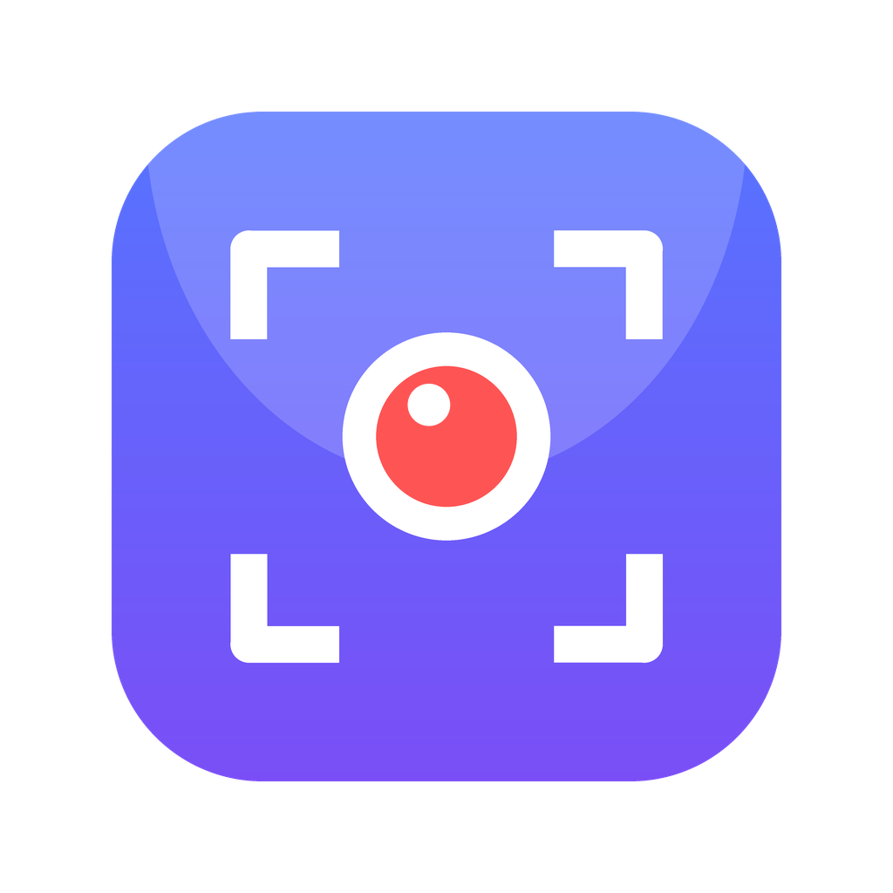
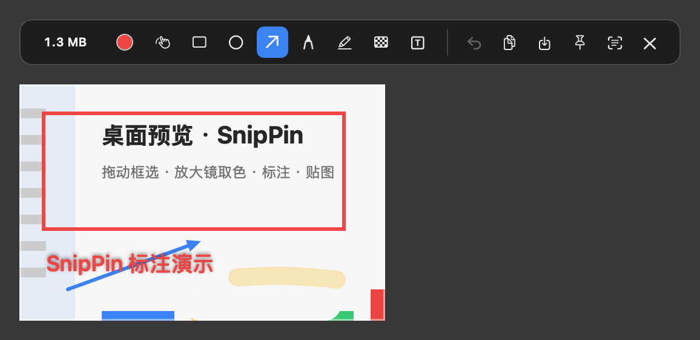
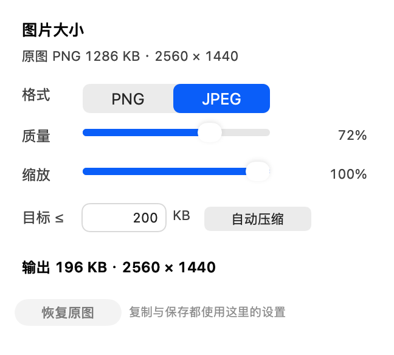
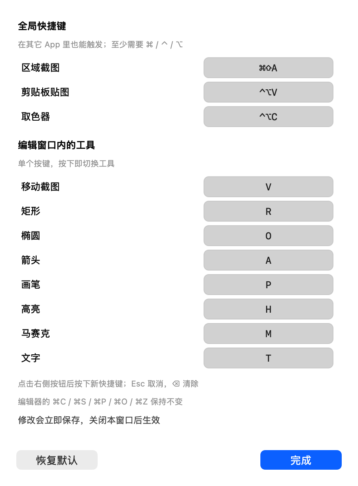

# SnipPin — macOS 截图 · 标注 · 贴图

一个用 Swift + AppKit 写的原生菜单栏截图工具，定位类似 Snipaste：**框选截图 → 标注 → 复制/保存/贴到屏幕上**。无第三方依赖，数据全部留在本地。





## 功能

- **区域截图**：全局快捷键呼出全屏冻结画面，拖动框选；十字辅助线、像素级放大镜、实时 HEX 取色、尺寸标注；按屏幕原生 2× 像素抓取（Retina 下不发虚）。
- **标注**：矩形、椭圆、箭头、画笔、高亮、马赛克、文字（7 种工具，`R O A P H M T` 切换），⌘Z 撤销，颜色循环切换。
- **随手拖动**：按 `V` 或按住**空格**拖动整张截图，可丢到桌面任意位置/任意显示器；工具栏会自动跟随，之后「贴图」也会落在当前位置。
- **快捷键自定义**：菜单栏 →「快捷键设置…」，可重录全局快捷键（截图/贴图/取色）和 8 个工具键，自动查重、冲突提示、一键恢复默认。
- **贴图置顶**：截图后按 ⌘P 钉在屏幕最上层；可拖动移动、滚轮缩放、⌥滚轮调透明度、⌥拖动把图片拖进其它 App、双击关闭、右键菜单（复制/保存/OCR/透明度）。
- **输出**：⌘C 复制、⌘S 保存，回车或双击直接复制并关闭。
- **大小显示与压缩**：工具栏最左侧实时显示当前图片大小（KB/MB）；点它打开面板，可选 PNG/JPEG、质量、缩放，或填一个「目标 ≤ N KB」让 App 自动压到目标以内（复制与保存都生效）。


- **OCR**：Vision 框架本地识别中英文，结果可编辑后复制（⌘O）。
- **取色器**：系统取色器，选中即复制 HEX（⌃⌥C）。
- **剪贴板贴图**：把剪贴板里的图片直接钉在屏幕上（⌃⌥V）。
- **延时截图**：菜单里可选 3 / 5 / 10 秒。

## 快捷键

> 下面都是默认值。菜单栏图标 →「快捷键设置…」可以随时改；截图/贴图/取色三个全局键改完关闭设置窗口立即生效。



| 快捷键 | 功能 |
| --- | --- |
| `⌘⇧A` | 区域截图 |
| `⌃⌥V` | 贴图：把剪贴板图片钉到屏幕 |
| `⌃⌥C` | 取色器（复制 HEX） |
| `V` / 按住 `空格` | 移动整张截图（拖到桌面任意位置） |
| `R / O / A / P / H / M / T` | 矩形 / 椭圆 / 箭头 / 画笔 / 高亮 / 马赛克 / 文字 |
| `⌘Z` | 撤销 |
| `⌘C` / `↩` / 双击 | 复制到剪贴板并关闭 |
| `⌘S` | 保存（PNG/JPEG，按大小面板设置） |
| `⌘P` | 贴图到屏幕 |
| `⌘O` | OCR 识别文字 |
| `Esc` | 取消 / 关闭 |

## 安装

```bash
cd SnipPin
./scripts/build_app.sh --install     # 构建 + 安装到 ~/Applications + 启动
```

只构建不安装：`./scripts/build_app.sh`，产物在 `build/SnipPin.app`。

首次启动会提示授予**屏幕录制**权限：

1. 点欢迎弹窗里的「去授权」（或在菜单栏图标里点「⚠️ 屏幕录制权限」）；
2. 在「系统设置 → 隐私与安全性 → 屏幕与系统音频录制」中勾选 **SnipPin**；
3. 授权后 App 会自动检测并重启（也可以手动「重新检查权限并重启」）。

> macOS 只在进程启动时读取该权限，所以授权后必须重启 App 才能截图。

## 开发

```bash
# 构建（注意本机 sandbox 需要 --disable-sandbox 与本地缓存目录）
swift build --disable-sandbox --scratch-path .build --cache-path .cache/build

# 截图管线自检（写入 /tmp/snippin-selftest.png，并跑一次 OCR）
./build/SnipPin.app/Contents/MacOS/SnipPin --selftest

# 离屏渲染 UI 预览（不需要屏幕录制权限）
./build/SnipPin.app/Contents/MacOS/SnipPin --render-demo /tmp/snippin-demo

# 实机烟囱测试：显示遮罩/编辑器/贴图并用 ScreenCaptureKit 截图
./build/SnipPin.app/Contents/MacOS/SnipPin --live-test /tmp/snippin-live

# 重新生成图标
python3 scripts/make_icon.py && iconutil -c icns Resources/AppIcon.iconset -o Resources/AppIcon.icns
```

## 结构

```
Sources/SnipPin/
  AppDelegate.swift        菜单栏、全局快捷键、截图编排、权限引导
  CaptureService.swift     ScreenCaptureKit 多屏截图 + 像素采样
  SelectionController.swift全屏冻结遮罩：框选、放大镜、取色、尺寸
  EditorController.swift   编辑器窗口、工具栏联动、复制/保存/贴图/OCR
  CanvasView.swift         标注模型与绘制（含马赛克像素化）
  ToolbarView.swift        浮动工具栏与按钮
  PinController.swift      贴图置顶窗口（拖动/缩放/透明度/拖出分享）
  OCRService.swift         Vision 文字识别
  OCRResultPanel.swift     识别结果窗口
  ImageOutput.swift        PNG/TIFF/剪贴板/Toast
  HotKeyManager.swift      Carbon 全局热键
  SnapshotDemo.swift       离屏预览 + 实机自测
```

## 验证情况

在 macOS 27.2 / 2560×1440 显示器上做过实机烟囱测试（`--live-test`）：

- ScreenCaptureKit 截图 2560×1440 正常；
- 全屏遮罩、放大镜、HEX 取色、尺寸标注正常；
- 编辑器 / 工具栏 / 贴图窗口正常合成，透明 PNG 编码 90 KB；
- Vision OCR 识别出 358 个字符（中英文混排）；
- 剪贴板写入 PNG + TIFF 正常。

## 快捷键设置

- 点右侧的按键框，直接按下新的组合键；`Esc` 取消录制，`⌫` 清除该快捷键。
- 全局快捷键至少需要 `⌘` / `⌃` / `⌥` 之一；工具键必须是单个按键（空格/回车/Tab/Esc 保留给编辑器）。
- 同一个分区内重复会直接提示并拒绝；全局键若被系统或其它 App 占用，关闭设置窗口时会提示。
- 录制期间全局快捷键会临时停用，避免按到旧键触发截图。
- 设置保存在 `~/Library/Preferences/com.zouhuu.snippin.plist`，恢复默认可一键还原。

## 图片大小面板

- 工具栏最左侧的 `177 KB` 就是当前导出大小（改标注会实时更新；超过目标值时变橙色）。
- 点击后：
  - **格式**：PNG（无损）或 JPEG（可调质量）。
  - **质量 / 缩放**：拖动后立即重新估算 KB。
  - **目标 ≤ N KB**：填数字并点「自动压缩」，App 会二分搜索质量（JPEG）或缩放比例（PNG），取目标以内最大的版本；直接保存/复制时也会自动按这个目标压缩。
  - **恢复原图**：一键回到 PNG / 100%。
- 复制与保存都使用面板里的设置；「贴图」和「OCR」始终使用原始全质量图像。
- 格式/质量/缩放会记住，目标 KB 不跨会话保留。

## 已知限制

- App 使用 **ad-hoc 签名**。重新构建并覆盖安装后，macOS 可能把它当成新 App，需要重新勾选一次屏幕录制权限；把 `.app` 固定放在同一路径、并保持 bundle id 不变可以减少这种情况。
- 马赛克为像素化（非高斯模糊），块大小约 12 物理像素。
- 标签/编号、滚动截图、窗口自动识别暂未实现。
- 截图默认不包含鼠标指针。
